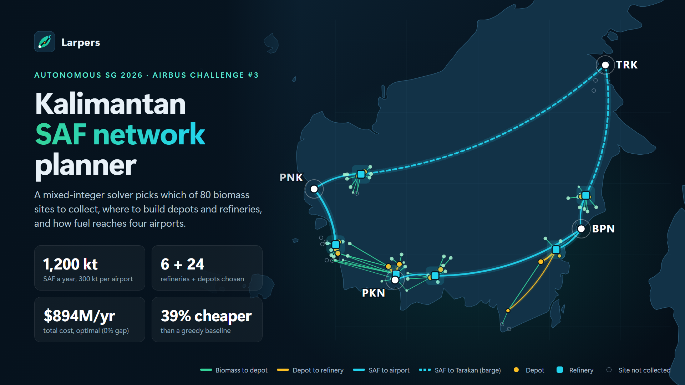
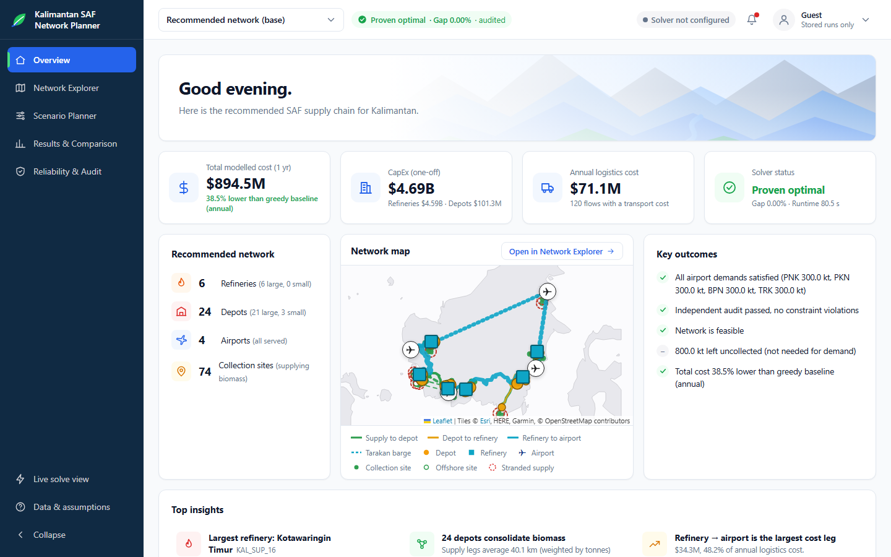
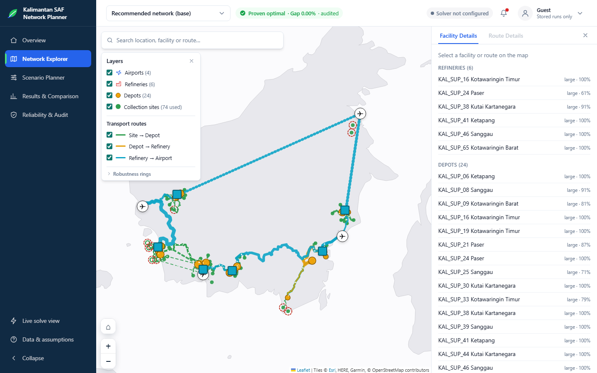
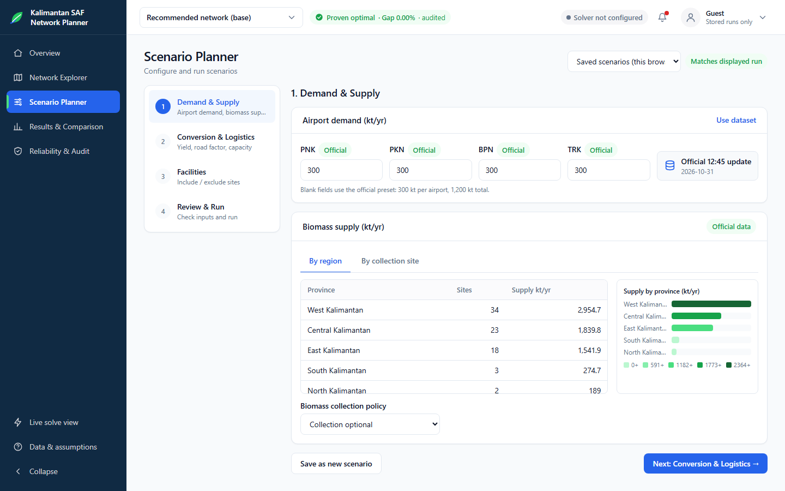
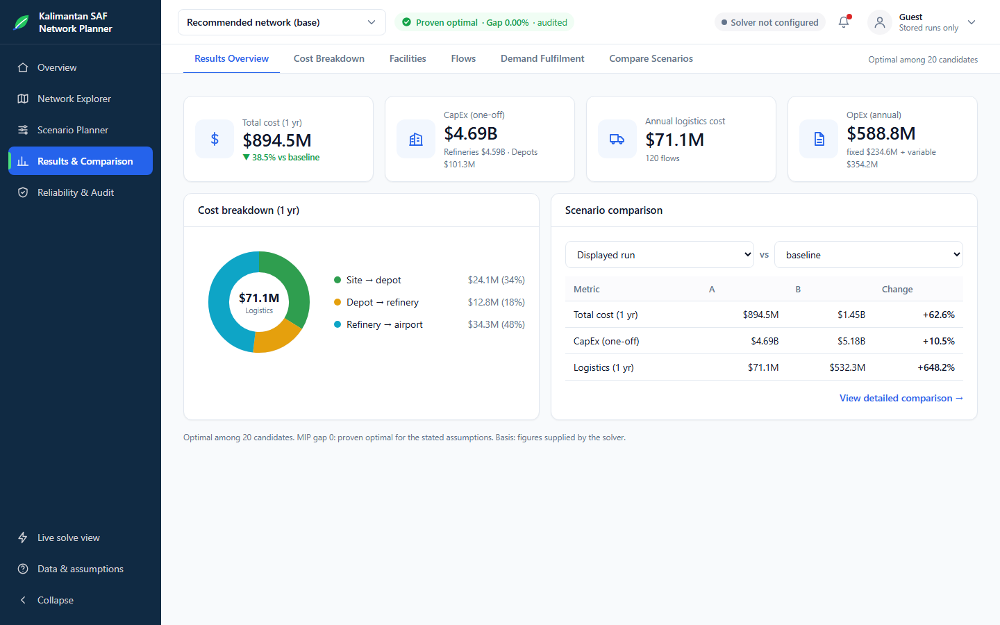
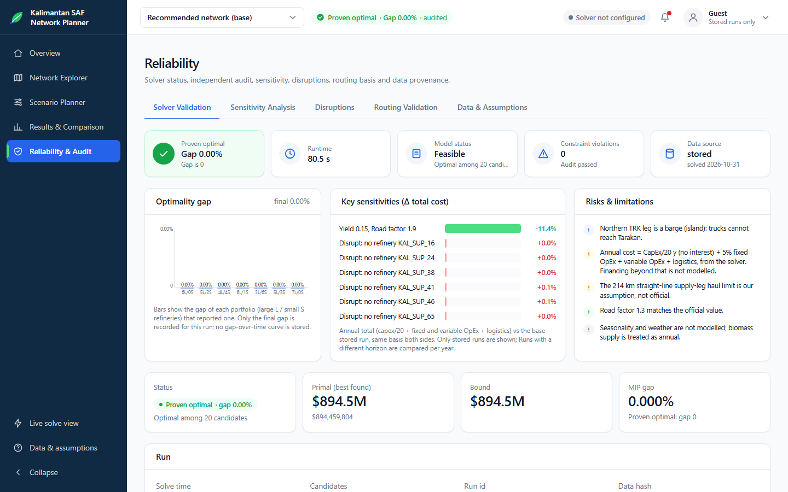
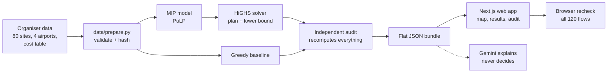

<div align="center">



# Larpers: Kalimantan SAF Network Planner

**A mixed-integer solver decides where to collect biomass, where to build depots and refineries, and how sustainable aviation fuel reaches four airports in Kalimantan, Indonesia.**

[](https://larpers-three.vercel.app/)


[Live demo](https://larpers-three.vercel.app/) · [How it works](#how-it-works) · [Quick start](#quick-start) · [Assumptions](docs/ASSUMPTIONS.md) · [Judge Q&A](docs/QA.md)

</div>

---

## The problem

A supply planner in Kalimantan has **6,800 kt of agricultural residue at 80 sites** and **four airports** (Pontianak PNK, Pangkalan Bun PKN, Balikpapan BPN and Tarakan TRK) that each need **300 kt of SAF a year**. They must decide which sites to collect from, where to open depots and refineries, and at what size. A large refinery costs $765M, so a plant in the wrong place spends the money before the first litre moves.

This is our entry for **Airbus Challenge #3 at Autonomous SG 2026**. The persona is ours, not a named Airbus customer.

## The result

The base case uses the organisers' official parameters from their 31 Oct 12:45 update.

| | Our solver | Greedy baseline |
|---|---|---|
| **Total annual cost** | **$894.5M** | $1.45B |
| Refineries / depots | 6 large / 24 (21 large, 3 small) | 7 / 26 |
| Annual transport cost | $71.1M | $532.3M |
| Airports fully supplied | 4 of 4 | 4 of 4 |
| Status | **Proven optimal, gap 0.00%**, among 20 refinery candidates | Heuristic |
| Independent audit | Passed, 0 violations | Passed |

**$560.1M a year cheaper (38.5%)** than the greedy plan. The solver leaves 800 kt of residue uncollected because demand needs only 6,000 kt. Removing any one of the six refinery sites and re-planning costs at most $0.9M a year more.

## Screenshots

<table>
<tr>
<td width="50%"><br><b>Overview.</b> Cost, solver status, the recommended network and key outcomes on one screen.</td>
<td width="50%"><br><b>Network Explorer.</b> Every site, depot, refinery and route on a map, with layer toggles and facility details.</td>
</tr>
<tr>
<td><br><b>Scenario Planner.</b> Change demand, yield, road factor or excluded sites, then re-solve. Official values are tagged.</td>
<td><br><b>Results &amp; Comparison.</b> Cost breakdown, every facility and flow, demand met, and any two runs side by side.</td>
</tr>
<tr>
<td colspan="2"><br><b>Reliability &amp; Audit.</b> Optimality gap, independent audit results, sensitivities, disruptions, routing checks and every assumption, marked official or ours.</td>
</tr>
</table>

## How it works



1. **Data.** `data/prepare.py` validates the organisers' files, selects airports by IATA code, and fingerprints every input with a SHA-256 `data_hash`.
2. **Model.** A two-level capacitated facility location model, written as a mixed-integer program. It chooses which depots and refineries to open, their sizes, and the flow on every route.
3. **Solver.** HiGHS finds the best plan and proves a lower bound on cost. When the two meet (gap 0), the plan is proven optimal among the candidates searched.
4. **Audit.** `solver/audit.py` shares no code with the model. It recomputes 20 families of checks from the raw data: supply, balances, capacity, yield, demand, distances, haul limit, rates, costs and totals.
5. **Baseline.** A greedy rule-of-thumb planner runs on the same data, distances and haul limit, so the saving is measured against something concrete.
6. **Web.** A static Next.js app reads the audited results. The browser recomputes every flow's distance and cost again from coordinates.
7. **Explanation.** Gemini only explains a finished run. It sees facts computed from that run, must cite them, and every number it writes is checked before it is shown.

**A solver makes every decision. No language model is in the decision path.**

### The model in brief

- **Minimise** one year of cost: CapEx over 20 years (no interest) plus fixed OpEx of 5% of CapEx, variable OpEx per tonne in (depot $5/$4, refinery $60/$55, small/large), and transport at 0.10, 0.12 and 0.08 USD/t/km on the three legs.
- **Subject to** supply at each site, no mass loss at depots, capacity on biomass intake (depots 150/300 kt, refineries 500/1,087 kt), a 20% SAF yield, exactly 300 kt per airport, one facility of each type per site, and a 214 km straight-line haul limit on supply legs.
- **Distances** are great-circle km × 1.3 (the official road factor). Tarakan is an island, so its last leg is a barge at 0.08 USD/t/km.
- **Refinery mix** (number of large and small plants) is fixed per solve. Every mix that could still win is solved or provably skipped, and mixes run in parallel.

The full formulation is in the docstring of [`solver/model.py`](solver/model.py).

## Quick start

Needs **Python 3.12+**, **Node.js 18+** and Git. Run everything from the repo root.

**1. Set up Python and build the processed data**

macOS or Linux:

```bash
python3 -m venv .venv && .venv/bin/pip install -r requirements.txt && .venv/bin/python data/prepare.py
```

Windows (Git Bash):

```bash
py -3 -m venv .venv && .venv/Scripts/python -m pip install -r requirements.txt && .venv/Scripts/python data/prepare.py
```

`data/prepare.py` runs offline, needs no `.env`, and prints the `data_hash`. Activate the environment (`source .venv/bin/activate`, or `source .venv/Scripts/activate` on Windows) before the commands below.

**2. Solve and explore**

| What | Command |
|---|---|
| Solve the base case | `python -m solver.model` |
| Greedy baseline | `python -m solver.baseline` |
| Rebuild the stored runs in `web/data/bundle.json` | `python -m solver.scenarios` (`--tiers T1` for the first tier, `--fresh` to ignore stored runs) |
| Robustness by district | `python -m solver.sensitivity` |
| Tests | `python -m pytest tests/` |
| Local solver API | `uvicorn api.main:app --port 8000` |
| Web app | `cd web && npm install && npm run dev` |

The web app works without the API and shows the stored runs, clearly labelled. For live solves, set `NEXT_PUBLIC_SOLVER_API_URL=http://localhost:8000` in `web/.env.local` (see [`web/.env.example`](web/.env.example)) and see [`api/README.md`](api/README.md) for endpoints.

**3. Offline fallback**

[`fallback/index.html`](fallback/index.html) is a static build of the app with every stored run. Open it by double-click, with no server or login. Rebuild it with `cd web && npm run build:static`.

A rerun reuses a stored run only when its data hash, full scenario and solver version all match. `python -m solver.scenarios --stub --out /tmp/stub.json` checks the pipeline without a solver and refuses to write inside `web/`.

## Hosting and maintenance

Denzel will maintain the Vercel hosting in the **denz** team (`denz6`). As of **2 November 2026**, the transfer from the existing host is **pending**; the destination team has been verified, but ownership has not moved yet.

The published demo remains [larpers-three.vercel.app](https://larpers-three.vercel.app/). See [the hosting handover guide](docs/HOSTING.md) for the transfer steps and verification checklist. This handover requires no application code changes. The public demo shows stored runs; the local solver API is documented separately in [api/README.md](api/README.md).

## Repository layout

```
data/        raw organiser data (read-only), prepare.py, reference road tables
solver/      MIP model, candidate shortlist, audit, greedy baseline, scenarios, sensitivity
api/         FastAPI solver API, Gemini explanations
web/         Next.js app; web/data/bundle.json holds the stored runs
fallback/    static double-click build of the web app
tests/       pytest suite for data, model, audit, baseline, API and explanations
docs/        assumptions, decisions, Q&A, pitch and demo runbook
resource/    the organisers' challenge PDFs
```

## Data and provenance

| Data | Source | Notes |
|---|---|---|
| 80 biomass sites, 6,800 kt | Organisers, `data/raw/kalimantan_80_locations_6800kt_full_range.csv` | Treated as synthetic |
| Cost table, rates, truck sizes | Airbus Challenge #3 PDF, p. 3 | In `resource/` |
| Official parameters (yield, demand, OpEx, capacity basis, road factor) | Organisers' update, 31 Oct 12:45: `resource/Autonomous SG 2026_Summary of Updates.pdf` p. 2 and `data/raw/challenge3_parameters.xlsx` | Base scenario |
| Airports PNK, PKN, BPN, TRK | [OpenFlights](https://openflights.org/data), `data/raw/airports.dat` | Selected by IATA code only. ODbL, see below |
| Road distances, 84 × 84 | OSRM on OpenStreetMap, `data/reference/osrm_table_84.json` | Reference check only, never the cost basis. Bundled, never called at runtime |
| Onshore test | `global-land-mask` | 69 onshore sites are facility candidates |

`data/processed/hashes.json` holds SHA-256 hashes of the raw files and distance arrays, and every result carries that `data_hash`. Every input is marked official, assumed or computed in [docs/ASSUMPTIONS.md](docs/ASSUMPTIONS.md).

> **The biomass sites are treated as synthetic.** The tonnages look generated, and 11 of 80 sites (966 kt, 14%) plot in the sea off Ketapang, so they supply but never host a plant. Results show how the method behaves, not where to buy land. A real plan needs mill-level data.

## Assumptions and limits

- **Official base case.** The organisers' 12:45 update: yield 0.20, road factor 1.3, no mass loss at depots, capacity on biomass intake, 300 kt per airport, optional collection, one-year annualised cost.
- **Ours, not official:** the 214 km straight-line supply haul limit, one facility of each type per site, the 20-site refinery shortlist, split flows (a site may supply more than one depot) and the 69 onshore candidate sites.
- **"Optimal" means gap 0 among the refinery candidates searched.** A better plan using a site outside the shortlist is not ruled out. Otherwise a result says "Best found, gap X%", and a run that finds nothing says "could not find", not "does not exist".
- **The baseline is stricter.** It sends each site whole to one depot, so part of the saving comes from allowing split flows.
- **Not modelled:** moisture, seasonality, storage, financing beyond the organisers' annualisation, and real road or river networks.
- **Main failure case: Bulungan.** KAL_SUP_18 and KAL_SUP_70 sit next to Tarakan airport and far from every other site. The solver leaves them uncollected, and their value depends on the barge rate to Tarakan.
- **Earlier assumptions** (yield 15%, road factor 1.9, passenger-share demand) are kept as one labelled sensitivity run, `earlier_assumptions`. It only reached "best found, gap 10.6%" and is a different problem, not a like-for-like comparison.

## Documentation

| Doc | What it covers |
|---|---|
| [ASSUMPTIONS.md](docs/ASSUMPTIONS.md) | Every input, marked official, assumed or computed |
| [QA.md](docs/QA.md) | Answers to likely judge questions |
| [DECISIONS.md](docs/DECISIONS.md) | Design decisions and conflicts, with reasons |
| [DEMO_RUNBOOK.md](docs/DEMO_RUNBOOK.md) | How to run the live demo |
| [PITCH.md](docs/PITCH.md) | The three-minute pitch script |
| [NEXT.md](docs/NEXT.md) | Ideas for after the hackathon |
| [HOSTING.md](docs/HOSTING.md) | Vercel ownership handover, maintenance and verification |

## Team

Built in one day at Autonomous SG 2026 by **Larpers**:

| Member | Role |
|---|---|
| Jing Yuan | Solver and integration lead |
| Jun Sheng | Web app, login and fallback |
| Damien | Contract, audit, baseline, API, road routing |
| Denzel | Data and evidence |

## Licence and attribution

No open-source licence has been chosen yet, so all rights are reserved by the authors.

- **Airport data:** `data/raw/airports.dat` is the [OpenFlights](https://openflights.org/data) airport database, made available under the [Open Database License (ODbL) v1.0](https://opendatacommons.org/licenses/odbl/1-0/). Its individual contents are under the [Database Contents License (DbCL) v1.0](https://opendatacommons.org/licenses/dbcl/1-0/).
- **Road distances and map data:** © [OpenStreetMap](https://www.openstreetmap.org/copyright) contributors, routed with OSRM.
- **Map tiles:** Esri, HERE, Garmin and OpenStreetMap contributors, shown through [Leaflet](https://leafletjs.com/).
- **Challenge materials and biomass data:** provided by the Autonomous SG 2026 organisers and Airbus for Challenge #3.
